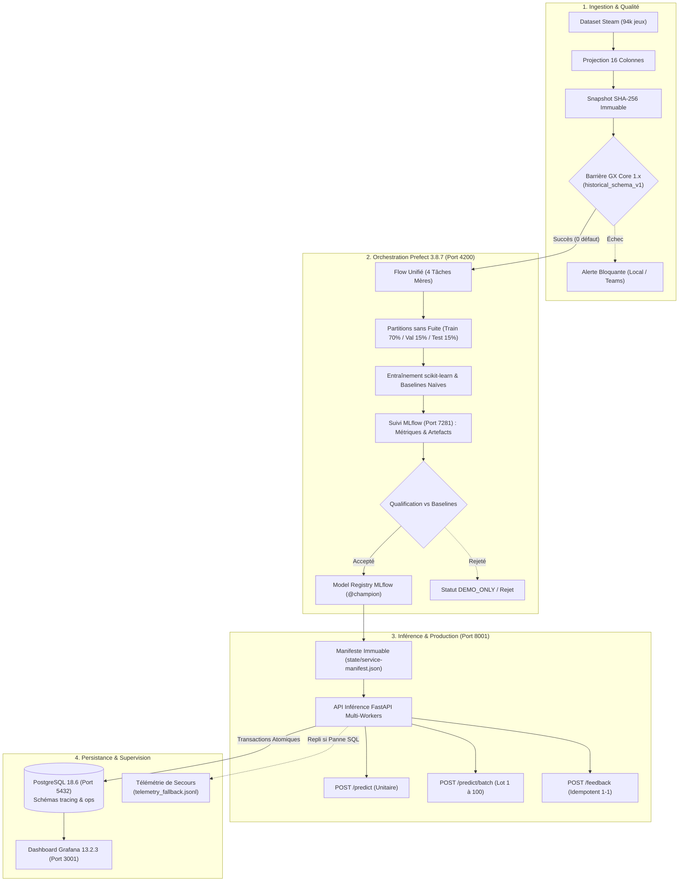

# Plateforme Industrielle MLOps — Catalogue Steam (Projet 5MLDE)

[](https://www.python.org/)
[](https://astral.sh/uv)
[](https://www.prefect.io/)
[](https://mlflow.org/)
[](https://fastapi.tiangolo.com/)
[](https://www.postgresql.org/)
[](https://grafana.com/)

Ce projet constitue le socle complet d'industrialisation MLOps pour l'analyse, la validation bloquante, l'entraînement reproductible, la qualification, le déploiement en ligne et la supervision de modèles de Machine Learning appliqués au catalogue de jeux de la plateforme **Steam** (94 948 titres analysés).

---

## 1. Périmètre & Problématiques Métier

Le système exploite le dataset Steam (`games_march2025_full.csv`) pour adresser **deux tâches prédictives conjointes** :

1. **Régression Continue — Pourcentage d'avis positifs (`pct_pos_total`) :**
   - **Cible :** Valeur numérique réelle $\in [0.0, 100.0]$.
   - **Critère d'éligibilité :** Représentativité statistique minimale (`num_reviews_total >= 10`).
   - **Baseline naïve :** Prédicteur naïf médian (`MAE = 13.91 %`, `R² = 0.0000`).
   - **Modèle déployé :** `RandomForestRegressor` (**MAE = `12.53 %`**, **R² = `0.1602`**, gain de +1.38 point).

2. **Classification Multiclasse — Tranche de propriétaires estimés (`estimated_owners`) :**
   - **Cible :** 12 classes réelles ordonnées (ex. `0 - 20000`, `20000 - 50000`, ..., `50000000 - 100000000`).
   - **Critère d'éligibilité :** Exclusion de la tranche `0 - 0` et seuil minimal de 5 jeux par classe.
   - **Baseline naïve :** Prédicteur majoritaire (`Accuracy = 73.04 %`, `Macro F1 = 0.0704`).
   - **Modèle déployé :** `RandomForestClassifier` (**Accuracy = `73.45 %`**, **Macro F1 = `0.1036`**).

---

## 2. Architecture Globale du Système



---

## 3. Matrice des Ports & Interfaces Web

| Service | Rôle | Port | URL Locale | Identifiants |
|---|---|---|---|---|
| **API Inférence** | Prédiction unitaire/lot, feedbacks, santé | `8001` | [http://127.0.0.1:8001/docs](http://127.0.0.1:8001/docs) | Aucun (public) |
| **API PUSH** | Ingestion passive & accumulation 500 jeux | `8000` | [http://127.0.0.1:8000/docs](http://127.0.0.1:8000/docs) | Header `X-API-Key` |
| **Grafana** | Supervision temps réel (19 panneaux) | `3001` | [http://127.0.0.1:3001](http://127.0.0.1:3001) | `admin` / `admin` |
| **MLflow Server** | Tracking d'expériences & Model Registry | `7281` | [http://127.0.0.1:7281](http://127.0.0.1:7281) | Aucun |
| **Prefect Server** | UI d'orchestration et historique des runs | `4200` | [http://127.0.0.1:4200](http://127.0.0.1:4200) | Aucun |
| **PostgreSQL** | Base relationnelle (schémas `tracing`, `ops`) | `5432` | `localhost:5432` | `postgres` / `postgres` |

---

## 4. Guide de Démarrage Rapide (Quickstart Reproductible)

Ce parcours est reproductible de bout en bout depuis une copie neuve du dépôt.

### 4.1. Prérequis Système
- **OS :** Windows 10/11 (PowerShell), Linux ou macOS (Bash).
- **Python :** Version `>= 3.12` installée.
- **Gestionnaire de paquets `uv` :** Indispensable pour la reproductibilité (`uv --version`).
- **Docker & Docker Compose :** Opérationnel pour la stack d'infrastructure.

### 4.2. Installation des Dépendances
```sh
# Synchronisation déterministe via le fichier de lock uv.lock
uv sync --locked
```

### 4.3. Démarrage de l'Infrastructure Docker
```powershell
# Windows PowerShell
cd infra; docker compose up -d --wait; cd ..
```
```sh
# Linux / macOS (Bash)
cd infra && docker compose up -d --wait && cd ..
```

### 4.4. Diagnostic d'Environnement
```sh
# Vérification de conformité des 4 conteneurs et des variables d'environnement
uv run --locked python scripts/doctor.py
```

### 4.5. Partitionnement et Entraînement Initial
```sh
# 1. Scellement des partitions stratifiées sans fuite (Train 70%, Val 15%, Test 15%)
uv run --locked python scripts/freeze_partitions.py --config config/training.historical.json

# 2. Entraînement orchestré Prefect (GX, scikit-learn + baselines, MLflow, qualification, promotion @champion)
uv run --locked python -m src.orchestration.tasks --snapshot data/snapshots/historical_projection.csv --batch-id initial

# 3. Qualification et génération du manifeste de service actif
uv run --locked python scripts/build_service_manifest.py --alias champion
```

### 4.6. Démarrage de l'API d'Inférence
```sh
# Démarrage du serveur Uvicorn sur le port 8001
uv run --locked uvicorn api_prediction.main:app --host 127.0.0.1 --port 8001
```

---

## 5. Exécution des Suites de Tests et Validation

Le projet comporte **114 tests automatisés** validant unitairement et en intégration l'ensemble de la chaîne :

```sh
# Exécution de la suite complète de non-régression (114 tests)
uv run --locked python -m pytest tests -q

# Tests d'intégration de l'API d'inférence et des transactions PostgreSQL
uv run --locked python -m pytest tests/integration/test_prediction_api.py tests/integration/test_postgres_transactions.py -v

# Tests de la matrice de charge Locust et dimensionnement
uv run --locked python -m pytest tests/integration/test_load_benchmarks.py -v

# Tests de résilience, reprise après panne et rollback
uv run --locked python -m pytest tests/integration/test_incidents_and_recovery.py -v
```

---

## 6. Démonstration des Incidents et du Rollback

Le script `scripts/demo_incident.py` permet d'exécuter et d'attester de manière autonome les scénarios de crise :

```sh
# 1. Injection d'un lot corrompu (interception par Great Expectations)
uv run --locked python scripts/demo_incident.py --scenario invalid-data

# 2. Crash contrôlé de PostgreSQL (sonde 503, repli local, reconnexion automatique)
uv run --locked python scripts/demo_incident.py --scenario postgres-down

# 3. Interruption réseau en cours de publication MLflow (réconciliation sans doublon)
uv run --locked python scripts/demo_incident.py --scenario mlflow-reconcile

# 4. Dégradation de modèle et retour arrière d'urgence (Rollback sans réentraînement)
uv run --locked python scripts/demo_incident.py --scenario model-rollback

# 5. Exécution globale des 5 scénarios avec génération automatique des rapports d'audit
uv run --locked python scripts/demo_incident.py --scenario all
```

Tous les rapports d'incidents correspondants sont archivés dans le dossier `reports/incidents/`.

---

## 7. Tests de Charge et Dimensionnement Technique

Les campagnes Locust ont permis de caractériser la scalabilité multi-workers de l'API :
- **Débit maximal unitaire soutenable :** **143.61 req/s** ($p_{95} = 90$ ms, 0.0 % erreur).
- **Débit vectorisé par lot (20 jeux) :** **58.24 req/s** (soit **1 164.81 jeux/s** et **2 329.62 inférences/s**, $p_{95} = 200$ ms).
- **Rapport de dimensionnement chiffré :** disponible dans le dossier `reports/`.
- **Commande de rejeu de la matrice :**
```sh
uv run --locked python scripts/run_capacity_matrix.py --workers 1,2,4 --scenarios single,batch,mixed --concurrency 10,25 --duration 15
```

---

## 8. Documentation du Projet

- **Documentation technique** (architecture, contrats de données, de modèle et d'API, exploitation, runbook de reprise, spécification OpenAPI) : dossier `docs/`.
- **Rapports et preuves** (matrice de conformité des exigences, dimensionnement, synthèse d'exploitation, rapports d'incidents) : dossier `reports/`.
