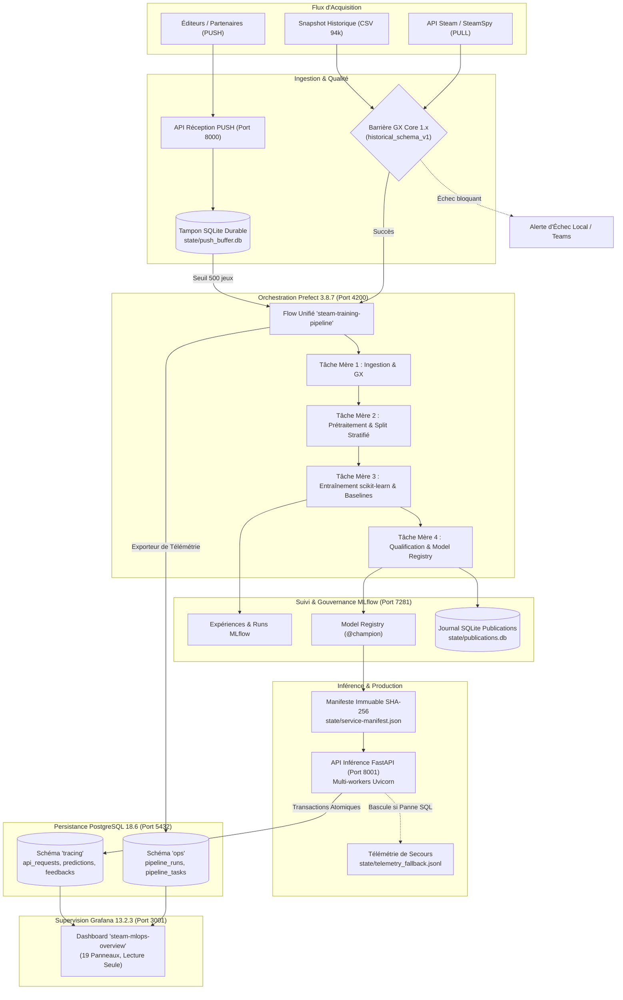
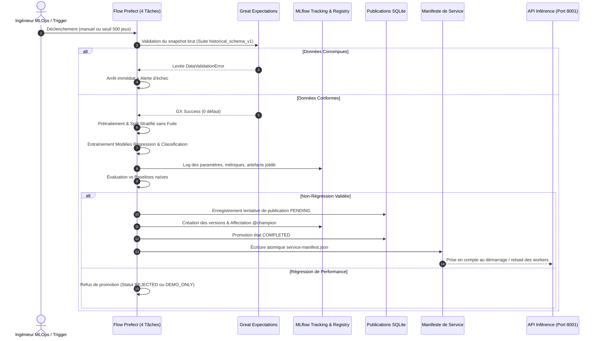

# Architecture Globale de la Plateforme Steam MLOps (docs/architecture.md)

> **Projet :** Industrialisation de Modèles Steam — MLOps 5MLDE  

---

## 1. Vue d'Ensemble & Principes Directeurs

La plateforme industrielle Steam MLOps répond au besoin de prédiction conjointe de la satisfaction communautaire (pourcentage d'avis positifs, tâche de régression) et de la volumétrie commerciale (tranche de propriétaires estimés, tâche de classification) sur l'ensemble du catalogue Steam.

Elle repose sur 5 piliers d'architecture logicielle :
1. **Ségrégation stricte des flux :** Isolation physique entre l'API d'acquisition PUSH (port 8000) et l'API d'inférence en ligne (port 8001).
2. **Immuabilité et non-régression :** Manifestes de service audités par empreinte SHA-256 (`state/service-manifest.json`), interdiction de résolution dynamique d'alias au runtime d'inférence.
3. **Barrière de qualité bloquante :** Great Expectations Core 1.x en garde défensive avant tout prétraitement ou calcul aval.
4. **Persistance relationnelle et atomicité :** Base PostgreSQL 18.6 dédiée avec séparation par schémas (`tracing` pour l'inférence/feedbacks, `ops` pour la télémétrie d'orchestration) et rôles à moindre privilège (`api_writer`, `ops_writer`, `grafana_reader`).
5. **Résilience et non-suppression d'historique :** Télémétrie locale de secours (`telemetry_fallback.jsonl`), réconciliation idempotente des publications MLflow, et préservation intégrale des audits en cas de rollback.

---

## 2. Diagramme d'Architecture Globale (Flux & Composants)

---

## 3. Matrice des Ports & Services Réseau

| Service | Composant | Port Hôte | Protocole | Authentification / Rôle | Rôle Opérationnel |
|---|---|---|---|---|---|
| **API PUSH** | FastAPI / Uvicorn | `8000` | HTTP / REST | API Key (`X-API-Key`) | Réception des nouvelles observations, accumulation durable |
| **API Inférence** | FastAPI / Uvicorn | `8001` | HTTP / REST | Publique / Header `X-Campaign-ID` | Inférence unitaire et lot, feedbacks, santé ready/live |
| **Grafana** | Grafana Community | `3001` | HTTP / Web | `admin:admin` | Tableaux de bord d'exploitation, métriques d'usage |
| **MLflow Server** | MLflow Tracking | `7281` | HTTP / Web | Ouvert en local | Suivi des runs, artefacts de modèles, Model Registry |
| **Prefect Server** | Prefect 3 Orchestrator | `4200` | HTTP / Web | Ouvert en local | Ordonnancement, états des tâches mères, UI des runs |
| **PostgreSQL** | PostgreSQL 18.6 | `5432` | TCP / PostgreSQL | `api_writer`, `ops_writer`, `grafana_reader` | Persistance relationnelle immuable et audit |
| **Récepteur Alertes** | Micro-serveur local | `9000` | HTTP / Webhook | Localhost strict | Réception des cartes JSON d'alertes en cas d'incident |

---

## 4. Ségrégation des Schémas et Sécurité des Données

L'architecture relationnelle PostgreSQL (`steam_mlops`) sépare hermétiquement les domaines de responsabilités :

### 4.1. Schéma `tracing` (Inférence & Feedbacks)
- `tracing.model_versions` : Répertoire immuable des couples de modèles enregistrés (clé primaire UUID, nom, version, run_id).
- `tracing.api_requests` : Journal d'audit de chaque appel API (clé primaire UUID, timestamp UTC, code HTTP, durées de traitement et d'inférence en millisecondes, PID worker, instance_id, révision Git, campaign_id).
- `tracing.predictions` : Persistance détaillée des $2N$ prédictions conjointes (clé primaire UUID, foreign key vers la requête, appid, tâche, résultat unitaire, features d'entrée JSONB).
- `tracing.feedbacks` : Vérités terrain et avis d'utilité avec détection d'idempotence stricte (cardinalité 1-1 par prédiction).

### 4.2. Schéma `ops` (Orchestration & Traitements)
- `ops.pipeline_runs` : Synthèse des exécutions Prefect 3 et des publications MLflow.
- `ops.pipeline_tasks` : États, durées et jalons des 4 tâches mères.
- `ops.export_sync_state` : Horodatage de synchronisation assurant la fraîcheur et la reprise idempotente de l'exporteur.

### 4.3. Sécurité et Rôles SQL
- `api_writer` : Droits `INSERT`, `SELECT` et `UPDATE` restreints sur `tracing` (aucun droit sur `ops`).
- `ops_writer` : Droits exclusifs d'écriture sur `ops` (aucun droit sur `tracing`).
- `grafana_reader` : Privilèges `SELECT` stricts en lecture seule sur les vues des deux schémas (interdiction formelle de `DELETE`, `UPDATE`, `DROP`).

---

## 5. Flux de Cycle de Vie d'un Modèle

---

## 6. Stratégie de Résilience et Haute Disponibilité

1. **Règle du Manifeste Immuable :** Les workers d'inférence Uvicorn ne contactent jamais le serveur MLflow pour chaque prédiction. Les versions sont figées au démarrage.
2. **Pool de Connexions Résilient :** Le `DatabasePool` gère l'abandon immédiat (timeout borné à 3s) lors d'un crash PostgreSQL et la reconnexion automatique sans redémarrage applicatif.
3. **Absence de Faux Succès :** Toute requête non persistée est explicitement rejetée en HTTP 503 et consignée dans `state/telemetry_fallback.jsonl`.
4. **Retour Arrière Sans Réentraînement :** La réactivation de `state/service-manifest.prev.json` permet de repasser sur la version précédente en quelques secondes sans recalcul.
