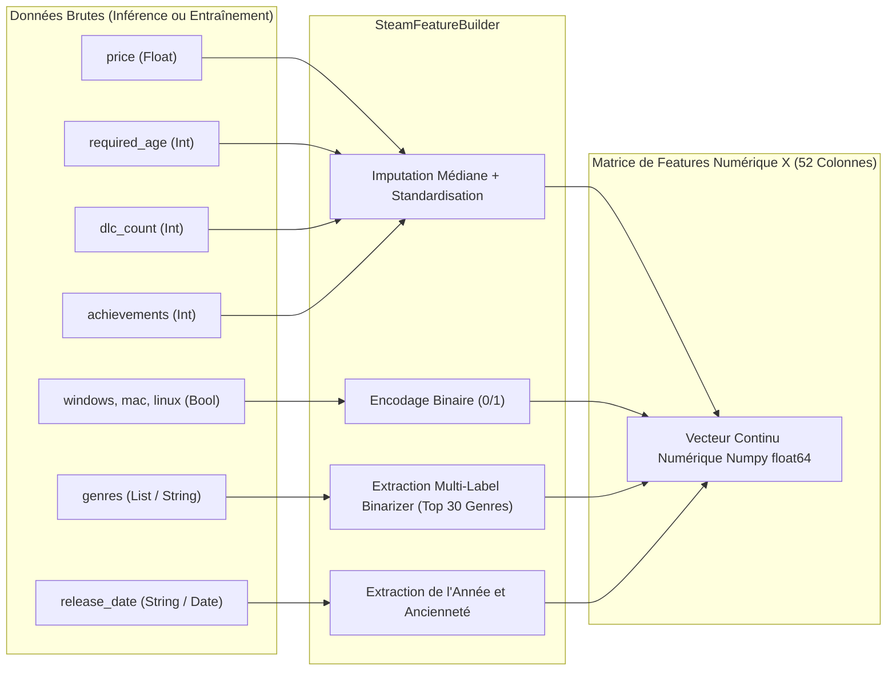

# Contrats et Spécifications des Modèles de Machine Learning (docs/model_contract.md)

> **Projet :** Industrialisation de Modèles Steam — MLOps 5MLDE  

Ce document formalise les contrats mathématiques, les critères d'éligibilité, les transformeurs de données et les règles de qualification des deux modèles de Machine Learning entraînés sur le catalogue Steam.

---

## 1. Description des Deux Tâches Prédictives

### 1.1. Tâche 1 : Régression Continue — Pourcentage d'Avis Positifs (`pct_pos_total`)

- **Problématique métier :** Estimer la satisfaction communautaire globale à partir des caractéristiques techniques et descriptives du titre.
- **Variable cible :** `pct_pos_total` $\in [0.0, 100.0]$ (valeur réelle flottante).
- **Population éligible (Règle d'éligibilité statistique) :**
  - Un jeu doit comporter au moins 10 avis totaux (`num_reviews_total >= 10`).
  - *Justification :* Les jeux avec 1 ou 2 avis ont une variance artificielle (100% ou 0%) dépourvue de signal d'apprentissage représentatif.
  - Taille de la population éligible dans le snapshot historique : **55 373 jeux**.
- **Baseline naïve de référence :** Prédicteur naïf médian (`DummyRegressor(strategy='median')`).
- **Modèle candidat retenu :** `RandomForestRegressor(n_estimators=100, max_depth=15, random_state=42)`.
- **Métriques d'évaluation :**
  - MAE (*Mean Absolute Error*) : cible principale (exprimée en points de pourcentage).
  - RMSE (*Root Mean Squared Error*) : sensibilité aux fortes déviations.
  - $R^2$ (*Coefficient de détermination*) : proportion de variance expliquée.
- **Règle de qualification :** $\text{MAE}_{\text{modèle}} \le \text{MAE}_{\text{baseline}} - 1.0$ point de pourcentage.

---

### 1.2. Tâche 2 : Classification Multiclasse — Tranche de Propriétaires Estimés (`estimated_owners`)

- **Problématique métier :** Prédire l'envergure commerciale d'un titre sans accès aux chiffres de vente privés des éditeurs.
- **Variable cible :** `estimated_owners` (variable catégorielle ordonnée sur 12 classes réelles).
- **Population éligible (Règle d'éligibilité commerciale) :**
  - Exclusion de la tranche sentinelle `0 - 0` (jeux sans estimation active).
  - Présence obligatoire d'au moins 5 jeux par classe dans le jeu d'ajustement.
  - Taille de la population éligible dans le snapshot historique : **81 290 jeux**.
- **Distribution des 12 classes cibles :**
  1. `0 - 20000`
  2. `20000 - 50000`
  3. `50000 - 100000`
  4. `100000 - 200000`
  5. `200000 - 500000`
  6. `500000 - 1000000`
  7. `1000000 - 2000000`
  8. `2000000 - 5000000`
  9. `5000000 - 10000000`
  10. `10000000 - 20000000`
  11. `20000000 - 50000000`
  12. `50000000 - 100000000`
- **Baseline naïve de référence :** Prédicteur majoritaire (`DummyClassifier(strategy='most_frequent')`).
- **Modèle candidat retenu :** `RandomForestClassifier(n_estimators=100, max_depth=15, class_weight='balanced', random_state=42)`.
- **Métriques d'évaluation :**
  - Accuracy : taux global de bonne classification.
  - Macro F1-score : moyenne non pondérée des F1-scores par classe, garantissant que les classes rares (blockbusters à +50M) ne sont pas ignorées au profit de la classe majoritaire (`0 - 20000`).
- **Règle de qualification :** $\text{Accuracy}_{\text{modèle}} > \text{Accuracy}_{\text{baseline}}$ ET $\text{F1-macro}_{\text{modèle}} > \text{F1-macro}_{\text{baseline}}$.

---

## 2. Transformeur de Features Scikit-Learn (`SteamFeatureBuilder`)

Le pipeline utilise un transformeur modulaire scikit-learn (`src/feature_builder.py`) garantissant l'absence de fuite et la reproductibilité :

### Propriétés du Transformeur :
1. **Hermétique aux variables cibles :** Aucune variable $Y$ n'est jamais acceptée ou lue lors de la transformation.
2. **Gestion robuste des valeurs manquantes :** Imputation déterministe basée sur les médianes calculées sur la partition Train.
3. **Résistance aux modalités inconnues :** Les nouveaux genres non présents lors de l'ajustement sont ignorés sans provoquer d'erreur.

---

## 3. Découpage Stratifié sans Fuite

Le snapshot historique est découpé de façon immuable par hachage d'identifiant (`appid`) via `scripts/freeze_partitions.py` :

| Partition | Proportion | Nombre d'Appids | Rôle et Usage | Fichier de Persistance |
|---|---|---|---|---|
| **Train** | 70 % | **66 463** | Ajustement exclusif des modèles et transformeurs | `data/partitions/train_appids.json` |
| **Validation** | 15 % | **14 242** | Qualification formelle et sélection `@champion` | `data/partitions/val_appids.json` |
| **Test Final** | 15 % | **14 243** | Évaluation finale scellée non manipulée | `data/partitions/test_appids.json` |
| **Réserve Protégée** | 30 % | **28 485** | Val + Test : Exclusion absolue du flux d'entraînement | `data/partitions/reserved_appids.json` |

---

## 4. Résultats Obtenus et Baselines de Référence

### 4.1. Régression (`steam-positive-ratio`)
- **Baseline Naïve (Médiane) :** MAE = `13.91 %`, RMSE = `18.66 %`, $R^2 = 0.0000$.
- **Modèle Candidat v12 :** **MAE = `12.53 %`**, RMSE = `17.10 %`, **$R^2 = 0.1602$**.
- **Gain observé :** Gain de `+1.38 point` de MAE par rapport à la baseline (seuil d'acceptation $\ge 1.0$ validé).

### 4.2. Classification (`steam-owner-range`)
- **Baseline Naïve (Majoritaire) :** Accuracy = `73.04 %`, Macro F1 = `0.0704`.
- **Modèle Candidat v12 :** **Accuracy = `73.45 %`**, **Macro F1 = `0.1036`**.
- **Gain observé :** Supériorité conjointe en exactitude globale et en discrimination des tranches marginales.
